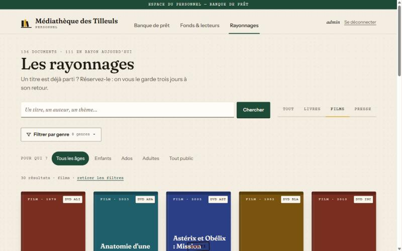
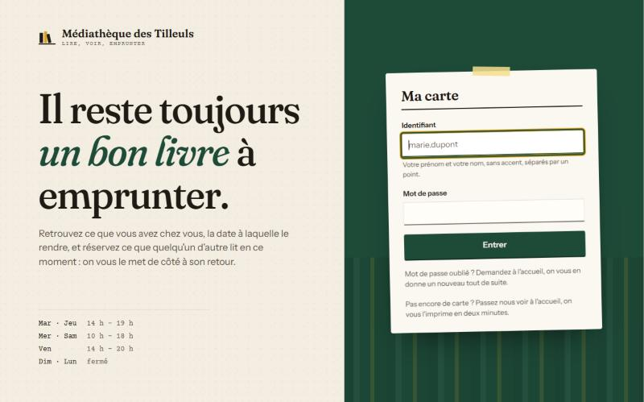
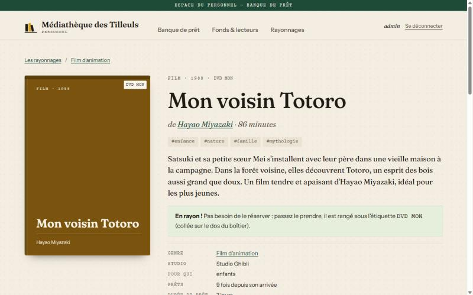
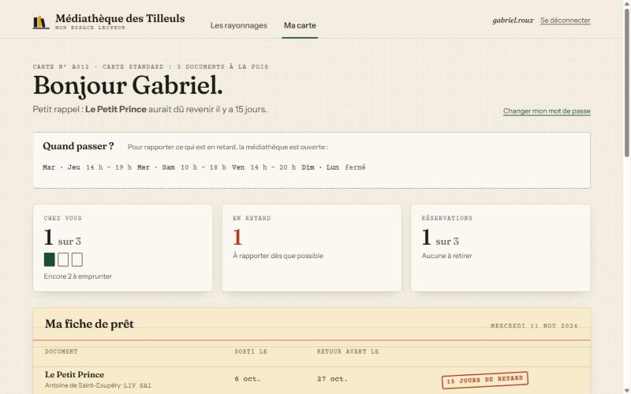
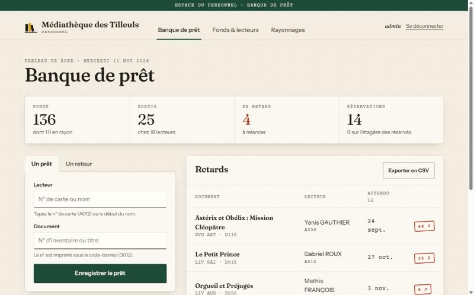

# Médiathèque des Tilleuls

[](https://github.com/Raffaele-Junia/ISEN-3/actions/workflows/mediatheque.yml)  

Application web de gestion de médiathèque, écrite en Python avec Flask. Les lecteurs y parcourent les rayonnages, consultent leur carte et réservent ce qui est sorti. Le personnel y gère la banque de prêt, le fonds et les lecteurs.

Projet personnel réalisé en 3ᵉ année à l'ISEN. Il est parti d'un petit modèle objet en console et a été étendu palier par palier : base SQLite, comptes et rôles, réservations, site web, fiches, recommandations. Chaque palier s'est accompagné d'audits de sécurité et de tests utilisateurs simulés.



## Ce qu'on peut faire

**En tant que lecteur**
- **Parcourir les rayonnages** : couvertures, filtres par type (livres, films, presse), par genre et par public (« Pour qui ? »). La recherche ignore les accents, cherche dans les résumés et connaît quelques synonymes (« sf », « bd », « polar », « anime »…).
- **Ouvrir la fiche d'un document** : résumé, thèmes, auteur ou réalisateur, cote de rangement, disponibilité ou date de retour prévue. Elle propose aussi « Du même auteur » et « Dans la même veine ».
- **Réserver** un document sorti. Au retour, il est mis de côté trois jours pour le premier de la file.
- **Ma carte** : documents chez soi et dates de retour, retards, réservations et rang dans la file, suggestions « Pour vous » avec leur raison (« Parce que vous avez lu 1984 »).

**En tant que responsable**
- **Banque de prêt** : enregistrer un prêt ou un retour en tapant le n°, le nom ou le titre. Le site indique pour qui mettre de côté un document réservé.
- **Retards** et export CSV, statistiques des plus gros lecteurs.
- **Fonds et lecteurs** : acquisitions avec leur fiche (genre, thèmes, résumé), retrait d'un document (avec confirmation), inscription d'un lecteur et de son compte en ligne, réinitialisation d'un mot de passe.
- **Fiche de chaque lecteur** : ce qu'il a chez lui (retour en un clic), ses réservations (annulables pour lui), tout son historique et son compte en ligne. On peut changer sa formule ou corriger son nom sans se connecter à son compte.
- **Journal** : chaque action du personnel est tracée (qui, quoi, quand). Le journal ne peut être ni modifié ni effacé, et il ne contient jamais de mot de passe.
- L'**historique des prêts** d'un document n'est visible que du personnel.

| Connexion | Fiche d'un document |
|---|---|
|  |  |
| **Ma carte** | **Banque de prêt (personnel)** |
|  |  |

## Démarrage rapide

Prérequis : **Python 3.14** et **[uv](https://docs.astral.sh/uv/)**.

```bash
uv sync
```

```bash
uv run python scripts/creer_demo.py demo.db
```

```bash
uv run python -m mediatheque.web.app --db demo.db
```

Puis ouvrir http://127.0.0.1:5000.

- La base de démonstration contient 136 documents, 45 lecteurs et 5 mois d'historique simulé. Sa création prend environ 25 s, car le hachage des mots de passe est volontairement lent.
- Les comptes de démonstration sont `admin` (responsable) et un compte `prenom.nom` par lecteur (par exemple `lea.martin`). Le mot de passe de test est indiqué en tête de `scripts/creer_demo.py`. Il ne doit jamais servir en dehors de la démo.
- **Optionnel :** les vraies couvertures des livres se téléchargent une fois depuis Open Library avec `uv run python scripts/telecharger_couvertures.py`. Sinon, le site dessine des couvertures typographiques.

> **Sur un réseau d'école ou d'entreprise**, si `uv` refuse le certificat de PyPI, ajoutez `--system-certs` à ses commandes (`uv sync --system-certs`, `uv run --system-certs …`).

### Pour une vraie médiathèque

```bash
uv run python -m mediatheque.init_db --depuis data --db mediatheque.db --admin admin
```

Le mot de passe du responsable est demandé au clavier. Le nom affiché se change avec la variable `MEDIATHEQUE_NOM`. Derrière HTTPS, définissez `MEDIATHEQUE_HTTPS=1` (cookie `Secure`). Le site doit tourner dans **un seul processus**, car les sessions et les compteurs anti-abus sont gardés en mémoire.

## Architecture

```
src/mediatheque/
├── documents.py, adherents.py, emprunt.py, reservation.py   modèle (Livre, DVD, Revue…)
├── mediatheque.py        moteur métier : prêts, retours, réservations, cohérence
├── auth.py               comptes, hachage scrypt, délai après échecs
├── session.py            SEULE porte d'entrée de l'interface : contrôle des rôles
├── journal.py            journal des actions du personnel (ajout seul)
├── recommandations.py    ressemblance (genre, thèmes, auteur) + co-emprunts anonymisés
├── stockage.py, stockage_sqlite.py   CSV et SQLite (transactions, migration automatique)
└── web/                  site Flask : app.py, templates/, static/
scripts/                  données de démo, fiches, téléchargement des couvertures
data/                     petit jeu utilisé par les tests ; data_demo/ : jeu de démo
docs/                     rapport de situation, audits de sécurité, panels UX, captures
```

Le principe clé : **les vues n'appellent que `Session`**, qui vérifie le rôle de l'utilisateur dans la couche métier. Masquer un bouton ne suffit jamais. Un lecteur ne peut agir que sur sa propre carte.

## Sécurité

Le projet a passé quatre audits (`docs/securite/`). Les 26 failles trouvées sont toutes corrigées, et chacune est verrouillée par un test.

- **Mots de passe :** scrypt (N=2¹⁷), un sel par compte, comparaison en temps constant, même message que l'identifiant existe ou non, délai progressif après plusieurs échecs, limite par adresse IP.
- **Web :**
  - jeton CSRF sur chaque formulaire ;
  - sessions gardées sur le serveur, qui expirent après 30 min d'inactivité ou 12 h au total ;
  - CSP qui interdit tout JavaScript ;
  - cookies `HttpOnly` et `SameSite` ;
  - échappement automatique du HTML.
- **Données :** SQL toujours paramétré, sauvegarde transactionnelle, rechargement de l'état si une action échoue en cours de route, contrôle de cohérence au chargement.
- **Vie privée :**
  - les recommandations ne révèlent jamais ce qu'un autre lecteur a emprunté (il faut au moins 3 autres lecteurs pour qu'un co-emprunt compte) ;
  - un lecteur voit quand un document reviendra, jamais qui l'a ;
  - les couvertures sont servies par le site lui-même, sans service tiers.

## Tests

```bash
uv run pytest -q -p no:cacheprovider
```

La suite compte 418 tests : modèle, réservations, stockage, comptes et rôles, site web, recommandations, et les tests de sécurité de `tests/security/`. L'option `-p no:cacheprovider` évite un conflit avec OneDrive.

## Méthode : les agents Claude du projet

Le dossier `.claude/agents/` contient trois agents réutilisables :

| Agent | Rôle |
|---|---|
| `security-tester` | Audite le code, prouve chaque faille par un test, rédige un rapport dans `docs/securite/` |
| `security-fixer` | Corrige les failles d'un audit, à raison d'un commit par faille |
| `panel-testeurs` | Fait tester le site par six personas (retraitée malvoyante, collégien sur téléphone, parent pressé, cinéphile, non-francophone, bibliothécaire) et produit un rapport UX priorisé dans `docs/ux/` |

Le panel a servi deux fois : la note moyenne est passée de **5,7 à 7,7/10** après les correctifs. Il s'agit de personas simulés. Leurs retours se confirment idéalement avec quelques vraies personnes.

## Données et droits

- Les titres, auteurs et réalisateurs du jeu de démo sont réels. Les résumés ont été rédigés pour le projet, et les lecteurs et l'historique de prêts sont fictifs.
- Les couvertures téléchargées depuis Open Library sont des œuvres protégées. Elles servent ici dans un cadre de catalogue et de projet étudiant, et ne sont **pas versionnées**.

## Auteur

Raffaele Farvacque, ISEN 3.
