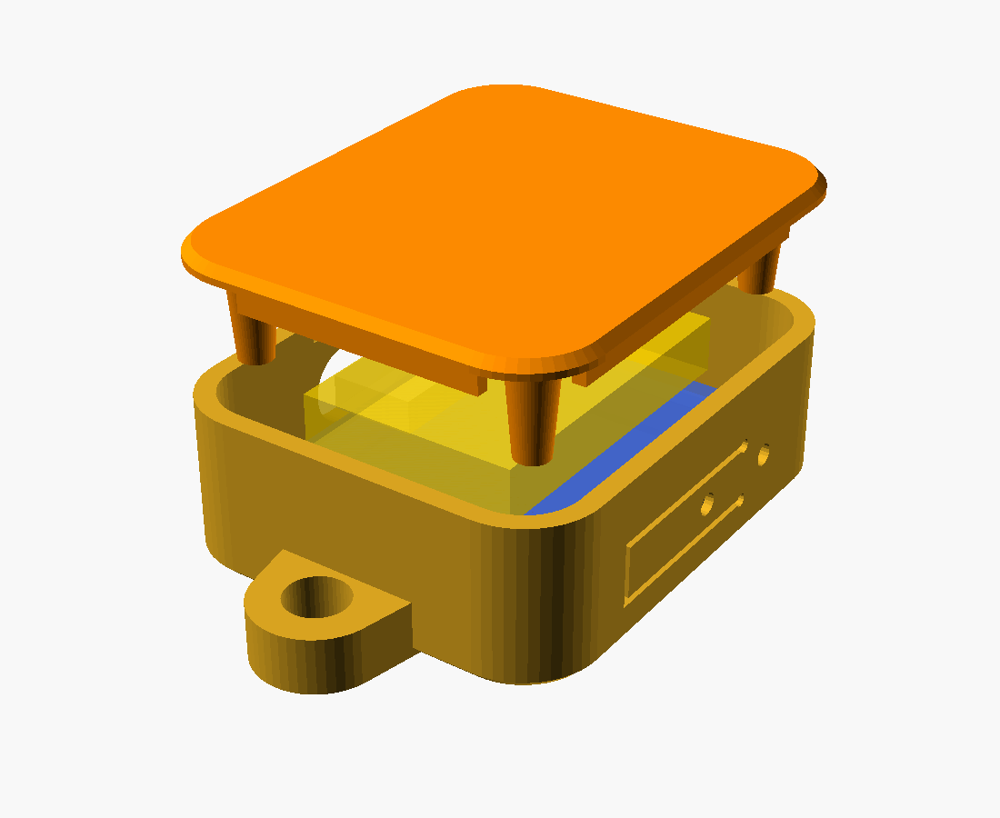

# Porte-clé « état du métro »

Un porte-clé à écran tactile qui affiche en direct quelles lignes du réseau ilévia
(Lille) sont interrompues ou perturbées. Un appui sur le bouton : il s'allume, lit les
perturbations en cours, puis se coupe tout seul.

```
metro-porte-cle/
├── firmware/MetroPorteCle/   croquis Arduino (ESP32-S3)
├── boitier/boitier.scad      boîtier paramétrique (OpenSCAD)
└── outils/simulateur.py      les mêmes règles sur PC, sur le flux réel
```

## État du projet

| Élément | Vérifié | Pas encore vérifié |
|---|---|---|
| Source de données | Flux interrogé en réel le 14/11/2026, y compris au format qu'utilise l'ESP32 (HTTP/1.0, réponse non découpée) | — |
| Règles d'état | 13 cas d'essai (`simulateur.py --test`) et lecture du flux réel pendant une interruption de la ligne 1 | — |
| Firmware | Compile sans erreur ni avertissement pour ESP32-S3 (cœur esp32 3.3.12, 1,1 Mo) ; brochage repris de la documentation et des exemples Waveshare | **Jamais essayé sur la carte** : écran, tactile et alimentation restent à valider en vrai |
| Boîtier | STL exportés, solides fermés d'une seule pièce ; géométrie contrôlée sur les rendus | **Jamais imprimé** ; trois épaisseurs de la carte sont estimées (voir plus bas) |

## Matériel

| Pièce | Détail |
|---|---|
| Carte | **Waveshare ESP32-S3-Touch-LCD-1.69** (la version *Touch*) : écran 1,69" 240×280, tactile capacitif, WiFi, chargeur LiPo et bouton marche/arrêt intégrés. 41 × 33 mm. Environ 20 à 25 €. |
| Accu | LiPo 3,7 V **502030** (5 × 20 × 30 mm, ~250 mAh) avec connecteur **MX1.25 2 broches**. Un 402030 convient aussi (régler `bat_ep = 4`). |
| Divers | Anneau porte-clé, câble USB-C, un morceau de mousse adhésive pour caler l'accu. |

> **Polarité de l'accu.** Les accus vendus avec un connecteur MX1.25 n'ont pas tous le
> rouge du même côté. Avant de brancher, compare avec les repères `+` / `−` gravés à
> côté du connecteur `BAT` de la carte. Une inversion détruit le chargeur.

Pourquoi cette carte plutôt qu'un Raspberry Pi ou un Arduino : un Arduino Uno n'a pas
de WiFi, un Raspberry Pi démarre lentement et consomme trop pour un petit accu. Ici
tout est sur une seule carte de la taille d'une montre, qui démarre en quelques
secondes et ne consomme rien une fois coupée.

## Ce que fait le firmware

- **Liste** : M1, M2 et le tramway toujours affichés, suivis des lignes de bus qui ont
  une alerte. État en couleur : Normal, Info, Perturbée, Partielle (interrompue sur un
  tronçon), Interrompue, avec l'heure de reprise annoncée.
- **Détail** : toucher une ligne ouvre le message complet d'ilévia, paginé.
- **Gestes** : glisser vers le haut ou le bas change de page ; glisser vers le bas en
  haut de liste relance la lecture ; dans le détail, `<` ou glisser à droite revient.
- **Bouton PWR** : appui = allumer ; appui court = mettre à jour ; appui long = éteindre.
- **Autonomie** : sur batterie, coupure complète après 45 s sans geste. Branché en USB,
  il reste allumé (écran atténué) et se met à jour chaque minute, comme un écran de bureau.

### Il lui faut du WiFi

L'ESP32 n'a pas de carte SIM. Dehors, le porte-clé passe par le **partage de connexion
du téléphone** : inscris ce réseau dans `secrets.h`, à côté de celui de la maison.

### D'où vient l'état des lignes

Jeu de données ouvert de la Métropole Européenne de Lille,
[« ilévia - Perturbations sur le réseau ilévia »](https://www.data.gouv.fr/datasets/ilevia-perturbations-sur-le-reseau-bus),
mis à jour chaque minute, sans clé d'accès.

Ce flux ne dit pas « la ligne est en panne : oui/non ». Il publie des messages rédigés
à la main, qui restent en ligne 24 h même une fois le métro reparti. Le firmware prend
donc le message le plus récent de chaque ligne et en lit le texte :

- « interrompue **jusque 11h 15** » → rouge jusqu'à 11h15, plus 10 minutes de marge ;
- « interrompue **entre les stations** … » → orange « Partielle » ;
- aucune heure annoncée → on y croit 2 heures ;
- « a repris », « rétabli », « circule à nouveau » → retour au vert.

Conséquence : si ilévia annonce 11h15 et que la panne dure sans nouveau message, le
porte-clé repasse au vert à 11h25. Les seuils sont dans `config.h`.

Les heures du flux portent un « Z » (UTC) mais sont en réalité en heure de Paris ; le
firmware en tient compte (`API_HEURES_LOCALES`).

## Programmer la carte

1. **Arduino IDE** → Fichier → Préférences → URL de gestionnaire de cartes :
   `https://espressif.github.io/arduino-esp32/package_esp32_index.json`,
   puis Outils → Carte → Gestionnaire de cartes → installer **esp32** (Espressif).
2. Croquis → Inclure une bibliothèque → Gérer les bibliothèques, installer :
   **Adafruit ST7735 and ST7789 Library** (accepter l'installation des dépendances)
   et **ArduinoJson** (version 7).
3. Dans `firmware/MetroPorteCle/`, copier `secrets.example.h` en `secrets.h` et y
   mettre les réseaux WiFi.
4. Ouvrir `MetroPorteCle.ino`. Menu Outils :
   - Carte : **ESP32S3 Dev Module**
   - USB CDC On Boot : **Enabled**
   - Flash Size : **16MB**, Partition Scheme : **16M Flash (3MB APP/9.9MB FATFS)**
   - PSRAM : **Disabled** (le croquis n'en a pas besoin)
5. Brancher en USB-C, choisir le port, téléverser. Si le téléversement ne démarre pas :
   maintenir **BOOT**, appuyer sur **RST**, relâcher BOOT, réessayer.

La même chose en ligne de commande, avec `arduino-cli` (installé sur ce PC) :

```bash
arduino-cli compile -b esp32:esp32:esp32s3:CDCOnBoot=cdc,FlashSize=16M,PartitionScheme=app3M_fat9M_16MB,PSRAM=disabled firmware/MetroPorteCle
```

Le fichier `secrets.h` existe déjà sur ce PC, copié du modèle : il reste à y mettre
les vrais réseaux WiFi.

Si, sur batterie, la carte s'éteint dès qu'on relâche PWR : c'est l'ancienne révision
de la carte, passer `CARTE_ANCIENNE_REVISION` à 1 dans `config.h`. Si l'image est à
l'envers : `ECRAN_ROTATION 2`.

Tester les règles sans la carte :

```bash
python outils/simulateur.py
```

## Imprimer le boîtier



Les fichiers prêts à trancher sont dans `boitier/stl/` : `coque.stl` et `couvercle.stl`,
déjà orientés pour l'impression. Ils correspondent aux valeurs par défaut du modèle.

Pour changer une cote, ouvrir `boitier/boitier.scad` dans [OpenSCAD](https://openscad.org),
modifier le paramètre, choisir `piece = "coque"` ou `"couvercle"`, F6 puis exporter en
STL. En ligne de commande :

```bash
openscad -o boitier/stl/coque.stl -D "piece=\"coque\"" boitier/boitier.scad
```

`assemblage` et `coupe` servent à visualiser, avec la carte en transparence
(`boitier/apercu/coupe.png` montre l'empilement verre, circuit, accu).

Dimensions hors tout : 37 × 54 × 16 mm, anneau compris.

- PETG de préférence (la lame du bouton fléchit), PLA possible.
- Couches de 0,2 mm, 3 périmètres, **sans supports**.
- La coque s'imprime façade sur le plateau, le couvercle plaque sur le plateau : c'est
  la disposition de `piece = "impression"`.

### Cotes à mesurer avant d'imprimer

Le plan Waveshare donne les cotes en largeur et en hauteur, **pas les épaisseurs**. Les
trois valeurs ci-dessous sont des estimations : mesure-les au pied à coulisse sur ta
carte et corrige-les en tête du fichier `.scad`.

| Paramètre | Valeur par défaut | Ce qu'il faut mesurer |
|---|---|---|
| `ep_ecran` | 3,2 mm | de la face avant du verre à la face avant du circuit |
| `ep_pcb` | 1,2 mm | épaisseur du circuit imprimé |
| `ep_composants` | 3,5 mm | hauteur du plus haut composant au dos (prise USB-C) |
| `ergot` | 1,3 mm | distance entre le bord du verre et le poussoir du bouton PWR, plus 0,25 |

Les positions de la prise USB-C et des boutons le long des flancs (`usb_y`, `pwr_y`,
`boot_y`, `rst_y`) sont relevées sur le dessin coté, à ±1 mm : à contrôler aussi.

### Montage

1. Brancher l'accu sur `BAT` (polarité vérifiée) et charger par USB-C.
2. Présenter la carte par le dos de la coque, écran vers la façade, boutons du côté de
   la lame. Écarter la lame de l'ongle si l'ergot accroche le verre.
3. Coller l'accu sur le couvercle, entre les deux nervures, avec la mousse.
4. Clipser le couvercle : ses quatre plots appuient sur les coins du circuit.
5. Les deux petits trous du flanc donnent accès à BOOT et RST avec un trombone.

Pour rouvrir : un ongle dans l'encoche du bord bas.

## Ajouter une ville

Tout ce qui est propre à Lille tient dans `ville_lille.cpp`. Pour une autre ville :

1. créer `ville_xxx.cpp` avec une fonction `charger(EtatReseau &)` qui interroge l'API
   de cette ville et remplit la liste des lignes (code, nom, couleur, état, message) ;
2. y définir une `Ville` (nom, fuseau horaire, fonction) et l'ajouter au tableau de
   `villes.cpp` ;
3. choisir `VILLE_ACTIVE` dans `config.h`.

L'écran, les gestes et l'alimentation ne changent pas.
